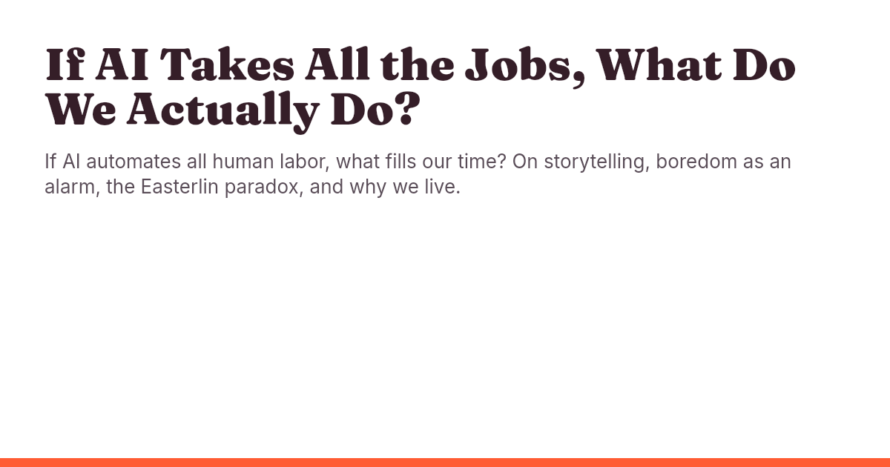
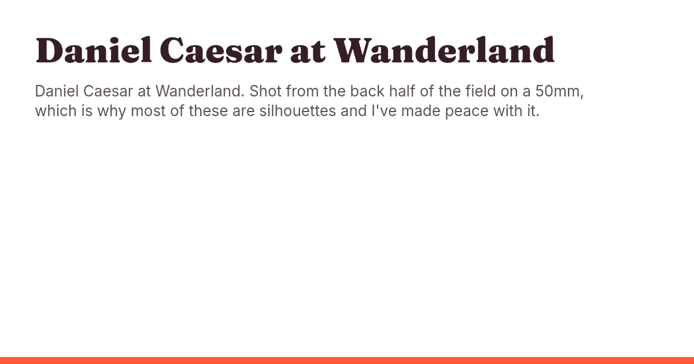

# Phase 31 — working notes

Records the phase file asks to put "in the PR". Work is happening directly on
`main` (no PR, per Paul's override), so they live here.

## 31.2 Tokens

**Colour reset.** Verified against tailwindcss.com/docs/theme (2026-10-29):
`--color-*: initial` removes every default colour utility in the namespace
(including `white`/`black`), leaving only the declared ones. Built CSS emits
exactly nine `--color-*` variables: red-500, red-700, blue-100, blue-200,
ink-900, ink-600, ink-400, paper, paper-100.

**Ladders.** `--step--2 … --step-5` and `--space-3xs … --space-3xl` copied
verbatim from `https://oddhalls.janpaulfernandez.com/_astro/Base.LfziiOH7.css`
(`:root`). They sit in `:root` as plain custom properties (not `@theme`), so
nothing tree-shakes them. `@theme static` was not needed.

**Step ↔ semantic name.**

| Semantic token | Points at | Range |
|---|---|---|
| `--text-micro` | `--step--2` | 11.5 → 12.5px |
| `--text-small` | `--step--1` | 13.1 → 14.4px |
| `--text-body` | fixed `1.0625rem` (§3.2; not a step) | 17px |
| `--text-lead` | `--step-1` | 18.7 → 22.7px |
| `--text-h3` | `--step-2` | 22.4 → 31.2px |
| `--text-h2` | `--step-3` | 28 → 46.4px |
| `--text-h1` | `--step-4` | 35.2 → 65.6px |
| `--text-display` | `--step-5` (= §3.2 display clamp) | 41.6 → 96px |

`--step-0` (16 → 18px) is defined but unmapped: body stays 17px fixed per the
phase file.

**Other decisions.**
- `--line` = `var(--color-blue-200)`. `--line-strong` and `--surface-1/2/3`
  deleted from `:root` (31.5 sweeps their remaining callers in components and
  pages; until then those declarations resolve to nothing).
- `--measure: 38rem` added to `:root`.
- `--ease-out-quint` kept (used by ~15 scoped `<style>` blocks for hover
  transitions); its GSAP comment deleted.
- `@layer base`: the dark-build webkit scrollbar styling was deleted rather
  than re-coloured (platform default on white). Focus ring moved to `red-700`
  here (it lives in base). Headings: h1/h2 Fraunces 500, `-0.02em`,
  `font-optical-sizing: auto`; h3/h4 Inter 600. Body drops `ss01` and the
  `-0.011em` tracking (31.9 judges by eye).
- `a` in base is now `red-700`, underlined (per 31.2 step 8). Every link that
  is *not* an inline prose link (nav, row links, buttons, cards, tags) must
  override colour and `text-decoration` — components do this in 31.3;
  utility-styled links in markup are 31.5/31.8's concern.

## 31.3 `global.css` components

**Usage inventory** (before the rewrite; counted as whole-token matches inside
string literals in `src/**/*.{astro,mdx,ts,md}` plus `astro.config.mjs`,
`<style>` blocks excluded — script in the session scratchpad, not committed):

| Class | Uses | Files | Fate |
|---|---|---|---|
| `.anchor-icon` | 1 | astro.config.mjs (rehype-autolink) | keep |
| `.anchor-link` | 1 | astro.config.mjs (rehype-autolink) | keep |
| `.brighten-line` | 1 | src/scripts/motion.ts only (dies in 31.4) | **deleted** |
| `.btn` | 17 | 8 | keep |
| `.btn-ghost` | 5 | 4 | keep |
| `.btn-primary` | 12 | 7 | keep |
| `.card` | 4 | 3 | keep |
| `.card-interactive` | 2 | 1 (ArticleLayout) | keep |
| `.display` | 16 | 15 | keep |
| `.faq` | 4 | 4 | keep |
| `.faq-mark` | 3 | 3 | keep |
| `.field` | 10 | 2 | keep |
| `.field-label` | 10 | 2 | keep |
| `.kicker` | 39 | 11 | keep |
| `.lead` | 16 | 14 | keep |
| `.link` | 6 | 4 | keep |
| `.link-arrow` | 11 | 6 | keep |
| `.mono` | 3 | 2 | keep |
| `.mono-micro` | 50 | 15 | keep |
| `.panel` | 9 | 6 | keep (hairline box; callers go in 32.6) |
| `.prose` | 5 | 5 | keep |
| `.rail` / `.rail-compact` / `.rail-date` / `.rail-item` | 1 each | Timeline.astro | keep |
| `.row-link` | 6 | 4 | keep |
| `.row-meta` | 4 | 3 | keep |
| `.row-title` | 5 | 4 | keep |
| `.rows` | 8 | 7 | keep |
| `.section` | 18 | 8 | keep |
| `.section-ruled` | 14 | 6 | keep |
| `.section-tight` | 11 | 6 | keep |
| `.shell` | 34 | 17 | keep |
| `.shell-narrow` | 3 | 1 | keep |
| `.skip-link` | 1 | 1 | keep |
| `.statement-sm` | 11 | 6 | keep |
| `.subtext` | 32 | 11 | keep |
| `.tag` | 8 | 7 | keep |

**Deleted:** `.brighten-line`, every `.js [data-reveal…]` / `[data-brighten]` /
`[data-revealed]` rule, the `.js` lines of the reduced-motion block, the
`.rail::before` linear-gradient (now a solid `--line`), the hover `:active`
scale on `.btn`, `.prose th` fill, `.prose code` border.

**Added:** `.panel-tint` (blue-100 ground, 1px `--line`, `--space-m` padding,
2px radius). It is the one class with **zero uses** in the final file — it is
required by rebuild-plan §7 and 31.3 step 2, and its first callers arrive in
Phases 32/34/36. Deliberate exception to "every class has ≥ 1 usage".

**Final check:** every other class selector in `global.css` has ≥ 1 usage
(same counting script, re-run on the finished file).

**Decisions.**
- `--line-strong` stays deleted (31.2). Nothing in the rewrite needed a
  stronger rule; hover states that used it now use `ink-400`.
- Base `a` is red-700/underlined, so every link-shaped component resets it:
  `a.card`, `.tag`, `.btn`, `.link-arrow`, `.row-link`, `.anchor-link`,
  `.skip-link` set `text-decoration: none` and their own colour.
- `.row-title`, `.faq summary`, `.btn` moved to Inter (§3.2: Fraunces is only
  display/h1/h2). `.display` and `.statement-sm` are Fraunces 500, `-0.02em`.
- `.row-link:hover` underlines the title (no colour shift, nothing moves).
- `.tag[data-active]` and the Now rail's live dot are red-500 fills (§3.1);
  other rail dots are blue-200.
- `.kicker`, `.mono-micro`, `.rail-date`, `.tag`, `.field-label` → 12px mono,
  `0.14em`; `.mono`, `.link-arrow` → 13px. `.field-label` and `.link-arrow` are
  ink-600 (read/acted on), not ink-400.
- `.prose` gets `max-width: var(--measure)` (38rem) and drops to 17px/1.6 per
  31.3 step 2 — narrower than the old 58rem article column. Wide tables still
  scroll inside it; check by eye in 31.9 (Phase 36 owns the article re-skin).
- `.section` = `--space-2xl`, `.section-tight` = `--space-xl`.
- `.prose code, .prose kbd` on blue-100 (no `<kbd>` in content today; the
  selector is spec'd and costs nothing). `pre` also blue-100 + hairline.

## 31.4 Remove motion

- `src/scripts/motion.ts` deleted; its `<script>` import removed from
  `BaseLayout.astro`; `gsap` uninstalled.
- Attributes stripped from 19 files with the phase file's perl regex (plus a
  `(?=[\s>\/])` lookahead so it can only end at an attribute boundary). No
  attribute carried a `{…}` expression. Diffs of Timeline, ArticleLayout,
  colophon, thoughts/index and index read by hand: no eaten attributes, no
  `class=""` orphans. Wrappers left in place.
- Four comments that described the motion system were rewritten (the `.js`
  script comment in BaseLayout per step 4; three in `index.astro`; one footer
  comment). The colophon's "Motion — GSAP + ScrollTrigger" stack row was
  deleted here because 31.4's gate needs zero `ScrollTrigger` hits in `src`;
  the rest of the colophon (Type row, header comment) is still 31.7's.
- `git diff v2-final -- src/content` is empty: no content file carried the
  attributes.
- After a clean build, no public page references `/_astro/*.js` (the three
  `.js` files in `_astro/` belong to the Keystatic admin). Built articles have
  4 `<script` tags: the `.js` class script, two GA4, and the mobile-menu
  inline script that 31.8 deletes.

## 31.5 Utility sweep

**Method.** A perl pass for the unambiguous text mappings (`text-paper-50/100`
→ `text-ink-900`, `-200` → `ink-600`, `-400`/`-600` → `ink-400`,
`text-wine-400` → `text-red-700`, and the same for `color: var(--color-…)`
in scoped styles), then every fill, border, rail, gradient and surface by
hand. Old meanings were inverted case by case: a `paper-*` *fill* became
`ink-900` (dots, pressed segment) or `blue-200` (quiet markers); an `ink-950`
*fill* became `paper` / `paper-100`.

**Checklist** (re-derived with the phase file's grep):
- [x] `src/styles/global.css` (finished in 31.2–31.3, untouched)
- [x] `src/layouts/BaseLayout.astro` — scoped nav/footer colours only; chrome left for 31.8
- [x] `src/layouts/ArticleLayout.astro` — TOC loses `--surface-1` fill, hairline `--line`; byline link ink-900 with a blue-200 underline
- [x] `src/components/PostListItem.astro` — title link ink-900, no underline
- [x] `Timeline.astro`
- [x] `Lightbox.astro` — the one dark exception, commented: scrim `color-mix(ink-900 94%)`, paper type, blue-200 metadata, red-500 link hover; `backdrop-filter` blur deleted
- [x] `blocks/Embed.astro` — `bg-ink-800` → `bg-paper-100`
- [x] `blocks/Callout.astro` — surface fill removed (hairline only)
- [x] `blocks/KeyTakeaway.astro` — wine gradient → `blue-100` tint, `--line` border, red-700 label
- [x] `blocks/PullQuote.astro` — rule `--line-strong` → `--line`
- [x] `src/pages/index.astro` — Now-list title links ink-900/no underline; `.statement` tracking −0.02em; kicker rule `bg-blue-200`
- [x] `about.astro` — scoped `.statement-sm` tracking −0.02em
- [x] `now.astro` — rail gradient → flat `--line`; nodes paper + blue-200 border; live node red-500; year node ink-900; `.tl-prose` → ink-600 (it is reading copy)
- [x] `colophon.astro` — `text-paper-600` dash → ink-400 (copy "near-black ground" is 31.7's)
- [x] `sitemap.astro` — card links ink-900/no underline; meta links ink-600; card hover borders removed (no `border-ink` utilities allowed)
- [x] `404.astro` · [x] `thanks.astro` — no old tokens; checked in browser
- [x] `src/pages/projects/index.astro` — `display-sm` kept as its scoped class (tracking −0.02em); row title ink-900; screenshot frame `paper-100`
- [x] `projects/[slug].astro` — `.eyebrow-back` gets `text-decoration: none`; frame `paper-100`
- [x] `gallery/index.astro` · [x] `gallery/[slug].astro` — tile placeholder `--surface-2` → `paper-100`
- [x] `thoughts/index.astro` — pressed segment ink-900 fill / paper type; pressed topic chip red-500 / ink-900 (matches `.tag[data-active]`)
- [x] `thoughts/[slug].astro` — no old tokens (uses ArticleLayout)
- [x] `topics/[topic].astro`
- [x] `src/pages/work-with-me.astro` — no old tokens; checked in browser
- [x] `workshops.astro` · [x] `workshops/[slug].astro` — rails flattened; seven reading-copy selectors (`.thesis__note`, `.avail__note`, `.stat__body`, `.why-prose p:last-child`, `.arc__desc`, `.caveat`, `.ladder__detail`) → ink-600
- [x] `src/content/**/*.mdx` — grep shows no classes; not edited

**Remaining `ink-400`.** Every hit reviewed: dates, counters, kickers, type
labels, separators, back-links, nav/footer links (31.8) — metadata only.

**Links.** Base `a` is red-700/underlined, so a computed-style scan over 16
routes listed every non-`.prose`, non-`.link` `<a>` in `<main>` that was red or
underlined. Remaining: the image-only gallery strip on Home (no text) and the
article TOC/byline (ink, underlined on purpose).

**Grep exception.** `grep -rn "wine-" src` still prints one line: a comment in
`src/pages/og/[...route].ts` naming the old OG colours. That file is task
31.6's and is re-themed there.

## 31.6 OG route

**Font loading.** `astro-og-canvas` 0.13.0's README names no font formats and
says nothing about variable fonts (it only says `fonts` takes file paths or
URLs; CanvasKit's `FontMgr.FromData` does the parsing). Tested rather than
assumed: the variable woff2 files load and render. Build log: `Loaded 2 font
families: Fraunces, Inter`. So the step-3 fallback (static instances in
`public/fonts/og/`) was **not needed**; `fonts:` points at
`@fontsource-variable/fraunces/files/fraunces-latin-opsz-normal.woff2` and
`@fontsource-variable/inter/files/inter-latin-wght-normal.woff2`.

**Gotchas.**
- The `FontConfig` key is `families: string[]`, not `family`. The old route used
  `family: 'Courier Prime'`, which the library ignores (it fell back to its
  default Noto Sans stack). Now `families: ['Fraunces']` / `['Inter']`.
- CanvasKit renders a variable font at its default instance and does not apply
  `weight`; the Fraunces title therefore comes out at the opsz file's default
  axis values, which reads heavier than the site's 500. Acceptable on a
  1200x630 card at 60px; if Paul wants it lighter, the fix is a static
  Fraunces instance (the step-3 fallback).
- Only `home` and `thoughts`-style cards use latin glyphs; the em dash and
  apostrophes in descriptions rendered fine (latin subset).

**Reviewed PNGs** (white ground, ink-900 Fraunces title, ink-600 Inter
description, red-500 12px rule at the bottom, nothing clipped, long title wraps
to two lines cleanly):
- `og/home.png` — 
- `og/thought.png` (If AI takes all the jobs…) — 
- `og/gallery-set.png` (Daniel Caesar at Wanderland) — 

**Cleanup.** `@fontsource/courier-prime` uninstalled; `public/fonts/switzer-*`
removed (the directory is now empty and gone). `grep -rn "wine-" src` → 0.
Remaining Switzer/Courier mentions: `colophon.astro` only (31.7).

## 31.7 Docs

**CLAUDE.md sections rewritten:** intro line; Workflow step 2 (phase files in
`docs/rebuild/phase-NN-*.md`, archive not `tasks/`); YAGNI (GSAP/Lenis
sentences removed); "Client JS" (replaced with the rule-7 budget); "Motion must
be removable" (deleted, `.js` guard folded into the Client JS bullet);
"Palette is dark" (now the v3 white palette); "Contrast has a ceiling"
(replaced by "`ink-900` is the darkest value"); the type-ramp bullet (three
tiers, `ink-*` names); the hairline bullet (`--line` = blue-200, `.panel-tint`
once per page); "Two families" (three, Fontsource variable); the dark-mode
parenthetical. Workflow, commands, YAGNI ladder, `@layer components`, rhythm,
schema parity, `@id` and the other surviving rules are untouched. No
branch-per-phase rule was added (work is on `main`). `AGENTS.md` / `GEMINI.md`
are one-line `@CLAUDE.md` imports. `.claude/skills/fable-frontend-developer/SKILL.md`
grep for wine|switzer|gsap|dark|data-reveal|courier|lenis|paper-|ink- → no hits;
no change needed.

**Colophon.** Type row now "Fraunces + Inter + JetBrains Mono" (variable,
Fontsource, self-hosted); the header comment no longer names Switzer/GSAP; the
"motion layer is the one deliberate exception" principle now says there is no
animation library; "one accent colour" and "near-black ground" lines updated
to the red highlighter and the white ground; meta description says three
typefaces. (The GSAP stack row was already removed in 31.4.)

**Done-when greps.**
- `grep -niE "wine|switzer|courier|gsap|lenis|data-reveal|dark|#FFF|paper-50|ink-950" CLAUDE.md`
  → two intentional hits, both negations: line 39 ("GSAP and the `data-reveal`
  vocabulary are gone") and line 50 ("Dark mode is not on the list … no dark
  theme to maintain").
- `grep -n "Switzer\|Courier\|GSAP" src/pages/colophon.astro` → 0.
- `grep -rniE "switzer|courier|gsap" src package.json` → 0.

## 31.8 BaseLayout chrome

- **Nav** (§4 order and wording): Work with me · Projects · Thoughts · Gallery ·
  About · Now; wordmark is the Home link. Workshops left the nav (pages stay
  until 32.6). `isNavActive` unchanged (Thoughts already covers `/topics/`).
- **Button:** "Book a scoping call" → `/work-with-me/#enquire`, `.btn
  .btn-primary`, in the header from 48rem up. The anchor lands in 32.4.
- **Mobile sheet:** native `

Menu
`
  with the six links and the button (the sheet's copy of the button is hidden
  from 48rem, where the header shows its own). The sheet is absolutely
  positioned under the bar on a paper ground with a `--line` rule — no shadow.
  The `aria-expanded` toggle and the inline menu script are deleted.
  Breakpoints are `@media` in the scoped `<style>`: desktop links ≥ 64rem,
  `
` < 64rem, header button ≥ 48rem.
- **Footer** (§4): the one-line Person summary, then Email · LinkedIn ·
  Instagram · RSS, Sitemap · Colophon · llms.txt, and `© {year} Paul
  Fernandez`. The summary is `PERSON_SUMMARY`, newly exported from
  `src/lib/schema.ts` as the first sentence of the Person description (the
  description is built from it, so it is byte-identical; test written first:
  non-empty and `person().description` starts with it). **GitHub omitted** —
  Blocked on Paul (plan.md).
- **Removed from the footer, decision for Paul's review:** the Phase 21
  statement ("Figuring out what to build, with the people who have to build
  it."), its "Work with me" red button, and the "Explore" column repeating the
  nav. §4 lists none of them, and the red button was a second red fill in the
  chrome. Restoring the statement is one `
`.
- **Also fixed here:** `<meta name="theme-color">` was the dark build's
  `#050505` and `color-scheme` was `dark`; now `#FFFFFF` / `light`. The unused
  scoped `.sr-only` rule went with the old style block.
- **Nav link colour** is ink-900 (CLAUDE.md: nav is ink-900), hover/current
  underlined; footer links ink-600.

**Done-when.** Built `dist/client/index.html`: `<script` tags are the `.js`
class script and the two GA4 tags (plus the `application/ld+json` data block,
which is not JS); `grep -c aria-expanded` → 0. Browser pane: 1280px shows the
wordmark, six links and the red button; 820px shows wordmark, button, Menu;
375px shows wordmark + Menu, and the open sheet lists six links and the
button. Keyboard: Tab goes skip link → wordmark → six links → button (1280)
and skip link → wordmark → summary (375); `Enter` opens and `Space` closes the
summary; focus outline is `rgb(164, 64, 47)` = red-700.
