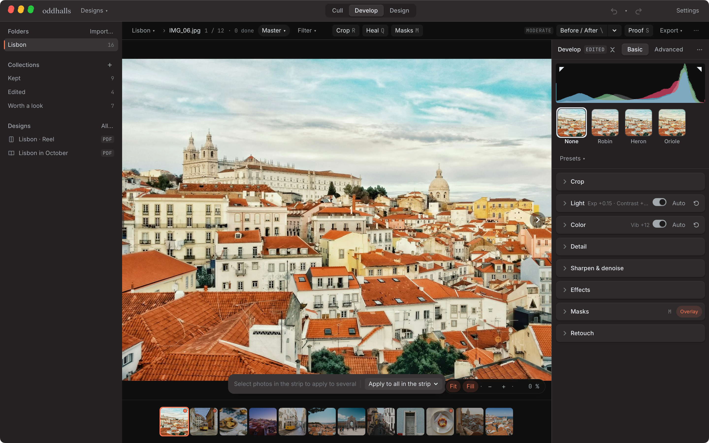
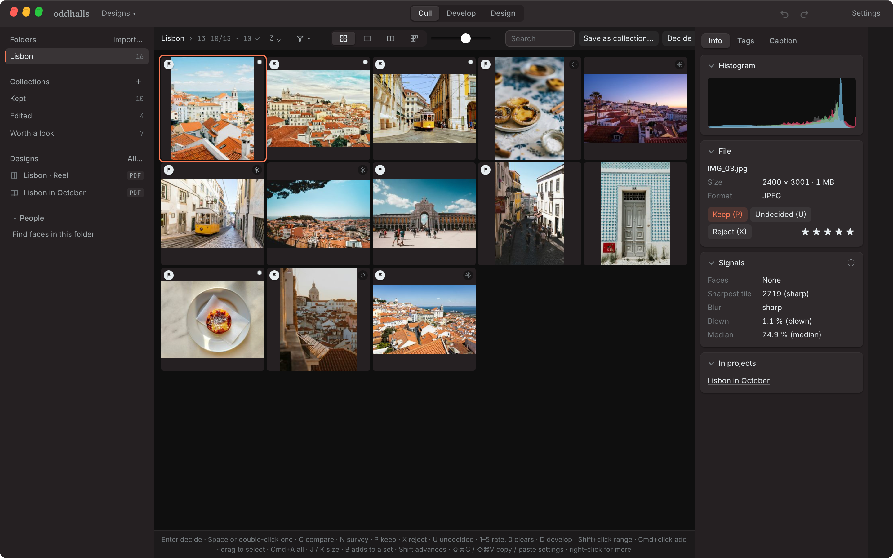
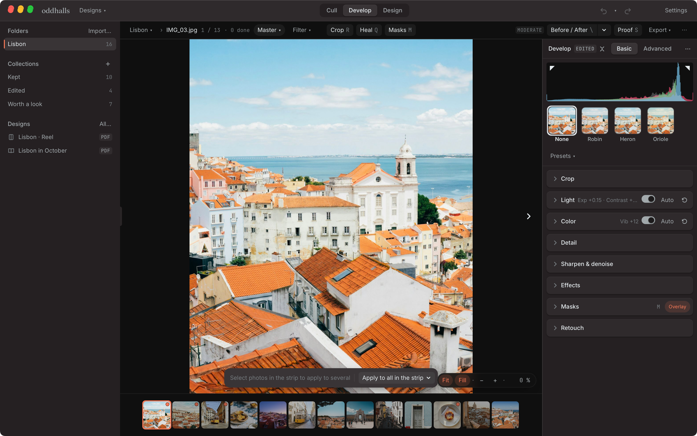
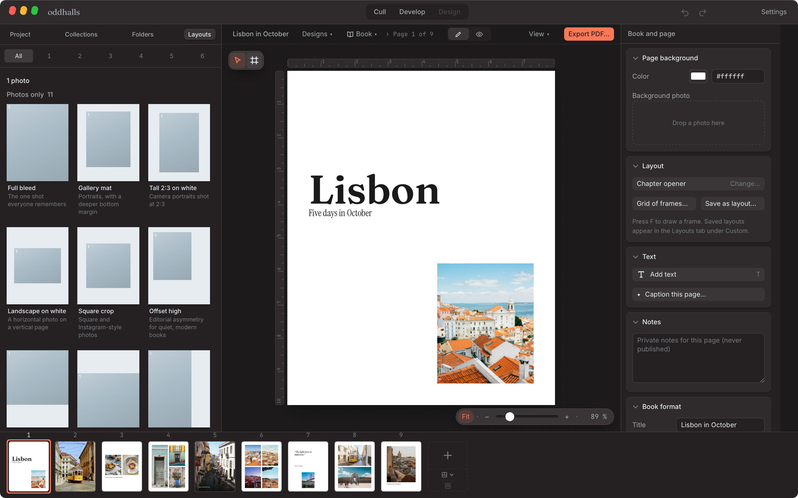
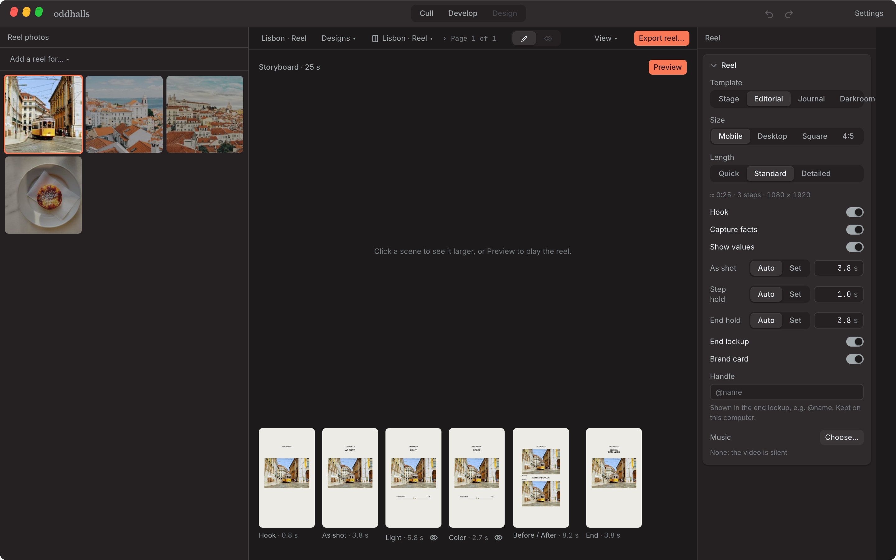
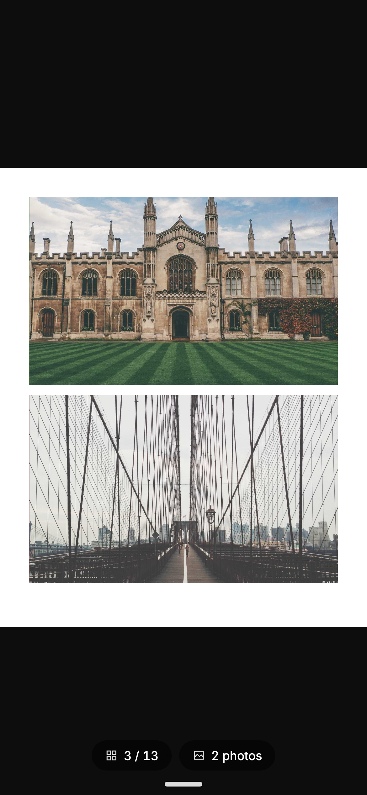

Beta v0.1.0 · macOS Apple Silicon · Free to use

A local-first photo editor and photobook designer built for the whole job after a shoot — from culling raw memory cards to published zines and reels.

[Explore feature breakdown ↓](#02--feature-breakdown)

| Fact | Detail | Note |
| --- | --- | --- |
| Platform | macOS Apple Silicon | macOS 13.4+ · Win & Linux in beta |
| Architecture | Local-first | Folders in place · no catalog DB |
| Color & RAW | 32-bit float GPU | 870+ cameras · Display P3 & sRGB |
| Inference | 100% on-device | SAM 2, BiRefNet, Depth Anything |

*Develop Stage (Hero). 32-bit floating point GPU pipeline on a Lisbon rooftop capture, featuring real-time tonal adjustments, tone curves, and looks shelf.*

## 01 · Background & Architecture

The post-shoot bottleneck.

Why Oddhalls was built

Photography has an unaddressed workflow problem after the shutter clicks. A single afternoon shoot generates hundreds of raw files. Processing them typically requires juggling four disjointed tools: a specialized culling app (like Photo Mechanic) to sort through frames quickly, a heavyweight catalog-based raw developer (like Lightroom or Capture One) with recurring monthly subscription fees, page design tools (InDesign, Figma, Canva) to format social carousels and print zines, and video editing suites to manually record before-and-after reels for social media.

Every transition between applications introduces friction, duplicate file exports, and catalog synchronization risks. Furthermore, conventional raw software increasingly pushes photographers toward cloud-dependent ecosystems where file libraries are tied to remote databases and subscription lock-in.

**Oddhalls** was engineered to solve this end-to-end pipeline in a single desktop application. Built with a local-first architecture on Tauri and Rust, it operates directly on existing photo folders without copying files, without a central catalog database, and without requiring a user account.

Edits and ratings are written non-destructively to small sidecar files beside original photos, leaving master RAWs entirely untouched. Local GPU acceleration handles raw decoding and real-time colour science, while modern neural vision models run directly on-device to power semantic masking, depth maps, and denoising with zero cloud telemetry.

## 02 · Feature Breakdown

Four sequential stages.

Designed in the exact order photographers work: from memory card ingestion to published zines and reels.

[Open Oddhalls in beta](https://oddhalls.janpaulfernandez.com)

### 01 Cull

Flag, rate, and group the shoot. Decide what stays.

*Cull Stage. Cull stage: multi-column grid with keep (P) and reject (X) flags, burst stacks, and seven diagnostic lenses.*

#### Lightroom-style key culling

Instant keyboard shortcuts (1–5 stars, P to keep, X to reject, U for undecided) with configurable auto-advance. Review one photo large (Space), compare two side-by-side with linked zoom and pan (C), or survey multiple picks at once (N).

#### Burst & scene clustering

Rapid camera bursts and temporal scene shifts group automatically. The app evaluates micro-contrast and local sharpness to suggest the sharpest, unclipped frame as the default keeper.

#### Decide sessions (1v1 duels)

A focused, distraction-free session for culling an entire shoot. In bursts, duels present two frames side-by-side: pick the winner with arrow keys. A scene coverage strip ensures you don’t over-cull early scenes.

#### Seven diagnostic lenses

Objective technical filters (Soft, Blown, Dark, Faces, Eye focus, Light, Busy) rank and badge files by local sharpness, highlight clipping, and exposure without ever changing user flags.

#### On-device face matching & IPTC

Local SFace neural embeddings identify recurring individuals across folders without cloud transmission. Full IPTC support for captions, copyright, creator metadata, and contest submission sheets.

### 02 Develop

Non-destructive 32-bit floating point RAW pipeline with local AI masks.

*Develop Stage. Develop stage: non-destructive tonal controls, color grading wheels with harmony locks, and 12 built-in film looks.*

#### 32-bit floating point GPU pipeline

Hardware-accelerated processing engine supporting JPEG, HEIC (macOS ImageIO 10-bit), and over 870 camera RAW formats through the rawler library. Wide-gamut colour management honors Display P3 and sRGB end-to-end.

#### Tonal and color controls

Exposure, white balance (Kelvin and tint for RAW), tone curves with presets (Soft S, Matte, Faded), HSL colour mix, texture, clarity, and dehaze.

#### Three-way color grading wheels

Shadows, Midtones, Highlights, and Global wheels with dedicated luminance sliders and color harmony locks (complementary, triadic, analogous) that move wheels in unison.

#### 12 built-in film looks & 3D LUTs

Curated film simulations named after birds (warm negative, cool negative, slide, pushed monochrome, cine print) with variable intensity sliders, alongside custom .cube 3D LUT import.

#### Local on-device AI masks

Zero-upload semantic masking powered by SAM 2, BiRefNet, and Depth Anything. Isolate subject, sky, background, people, and depth layers with one click, supplemented by linear, radial, and brush gradients.

#### Neural denoise & object removal

GPU-accelerated NAFNet and SCUNet denoise high-ISO files, while MI-GAN inpainting removes sensor spots and distractions directly on Apple Silicon.

### 03 Design

Zine-style photobooks, 300 DPI print spreads, social carousels, and before/after reels.

*Design Stage. Design stage: freeform and layout-driven canvas for photobook spreads, print zines, and social carousels.*

*Reel Editor. Automated Before-to-After MP4 generation for Instagram Reels, TikTok, and YouTube Shorts.*

#### Photobook & zine canvas

Multi-page canvas supporting phone portrait (4:5), story (9:16), square, and A4 formats. Intelligent snapping guides, proportional margins, and curated typographic hierarchy.

#### Facing-page spreads & 300 DPI print PDF

Spreads view mirrors physical books. Export high-resolution PDFs with 300 DPI photo rendering, configurable 3mm bleed, and printer trim marks for physical zine runs.

#### Multi-network social generator

Design once and adapt for Instagram carousels, TikTok slideshows, Bluesky, Threads, and Pinterest. Displays safe-area overlays and profile grid crop previews; exports numbered image sequences and caption files.

#### Before-to-after video reels

Computes standalone MP4 videos (9:16 vertical, 16:9 desktop, 1:1 square) illustrating the edit’s progression from RAW capture through develop steps to the finished grade, complete with hold times, audio beat-syncing, and brand cards.

### 04 Publish

Self-hosted to personal Cloudflare R2 with mobile-first reader and clean downloads.

*Publish Stage. Mobile viewer: lightweight, touch-optimized web reader with zero central tracking.*

#### Self-hosted Cloudflare R2 deployment

Books publish directly to the photographer’s personal Cloudflare R2 bucket. No central Oddhalls server, no user tracking, and completely free on standard tier allowances.

#### Mobile-first reader experience

Recipients open a lightweight web app on their phone or tablet, swiping through pages like a physical art book with responsive layout scaling.

#### Client proofing & full-res downloads

Generate unlisted review links with watermarked proof sheets and numeric pick submissions. Allow readers or clients to download full-resolution originals without cloud degradation.

## 03 · Technical Architecture

Built for privacy and native performance.

Every computationally intensive task runs locally on Apple Silicon. No remote GPUs, no server subscriptions, and no tracking.

| Spec | Detail |
| --- | --- |
| Shell & Backend | Tauri v2 + Rust |
| Rendering Pipeline | WebGL / WebGPU custom shader pipeline (32-bit float) |
| RAW Image Engine | rawler crate (870+ camera models supported natively) |
| Local Neural Models | SAM 2 (Meta), BiRefNet, Depth Anything v2, SFace, NAFNet, MI-GAN |
| Color Spaces | Display P3 and sRGB color-managed end-to-end |
| Metadata Standards | IPTC Core/Extension & XMP sidecars (.photobook/) |
| Publish Target | Self-hosted Cloudflare R2 bucket (S3 compatible) |
| Licensing & Cost | Free to use in beta · Open-source local models |

Available in Beta

## Try Oddhalls on macOS

Oddhalls is currently in public beta for Apple Silicon Macs. Download the app, view documentation, or explore the sample photobook online.

[Visit oddhalls.janpaulfernandez.com ↗](https://oddhalls.janpaulfernandez.com)

[Press Kit & Screenshots ↗](https://oddhalls.janpaulfernandez.com/press)
